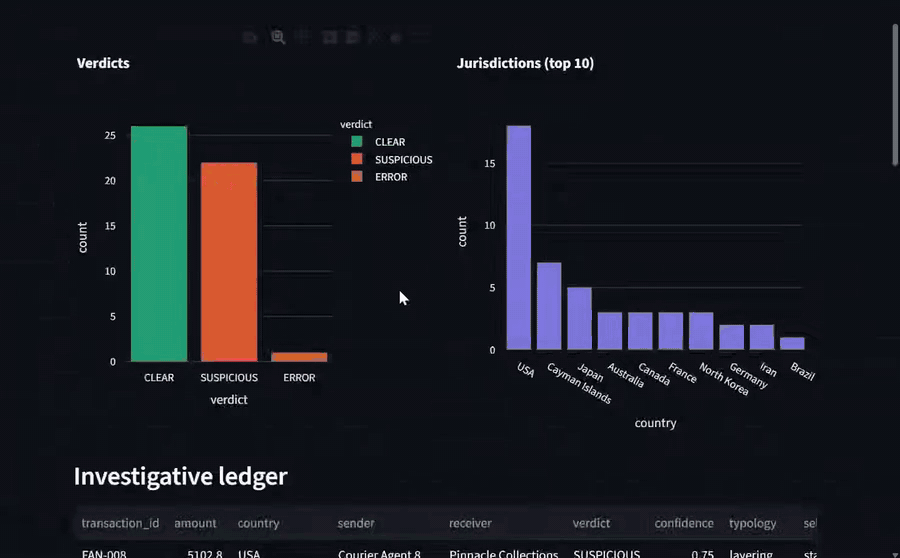
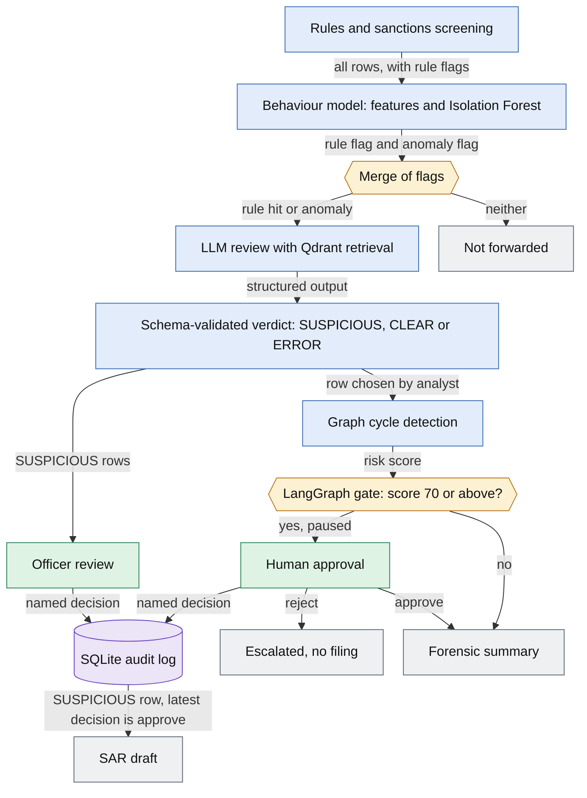

# Fintech Fraud Auditor

A tool that screens bank transactions for money laundering using rules, statistics, network analysis and an AI model, with a compliance officer making the final call.



*Demo on the bundled synthetic sample ledger: the AI review flags a circular flow, the topology score reaches the 70/100 review threshold, execution pauses for a named officer, and the decision is recorded in the audit log.*

## What it is

The tool reads a ledger of bank transactions and works out which ones look like money laundering. Quick rules and statistics pick out the suspicious transactions, an AI model reviews those against anti-money-laundering guidance, and a compliance officer must approve before a Suspicious Activity Report (SAR) is drafted. Every decision is recorded in an audit log.

## Why it's harder than it sounds

Banks handle huge numbers of transactions. Having an AI model review every one would be slow and expensive, but filtering too aggressively lets real laundering slip through unseen. Laundering is also designed to look ordinary: a large sum is split into transfers just under the reporting limit, or money is passed around a circle of accounts until its origin is hard to trace. The challenge is narrowing the list down cheaply without throwing away the cases that matter.

## How it works

1. **Rules** flag the obvious cases: names on sanctions lists, high-risk countries, and amounts split to stay just under the reporting limit.
2. **A pattern model** looks at how each account behaves and flags the unusual ones.
3. **An AI model** reviews the flagged transactions against compliance guidance and gives a clear verdict.
4. **A network check** looks for money travelling in a circle through several accounts.
5. **A compliance officer** makes the final decision, and every step is written to an audit log.

## Results

Measured on a synthetic ledger of 465 transactions, 45 of them labelled as laundering:

| Pipeline | Laundering caught (recall) | Flags that were real (precision) | Sent to the AI model |
|---|---|---|---|
| Original order (statistics first) | 7% | 33% | 9 rows |
| Current order (rules first) | 84% | 78% | 49 rows |

By type of laundering:

| Pattern | What it looks like | Caught |
|---|---|---|
| structuring | One large sum split into transfers just under the $10,000 limit | 10 of 10 |
| sanctioned | Transfers involving a high-risk jurisdiction | 6 of 6 |
| fan_in | Many accounts sending money into one account | 11 of 11 |
| circular | Money sent around a loop in large amounts | 3 of 3 |
| circular_small | The same loop in smaller amounts, through new accounts | 7 of 7 |
| circular_camouflaged | The same loop through established businesses | 1 of 8 (known gap) |

The same author wrote both the detector and the test data, so treat these numbers as a regression check rather than a real-world detection rate. The method, the caveats and the reasoning behind each number are in [docs/EVALUATION.md](docs/EVALUATION.md).

### LLM review tier

The AI review is evaluated on three synthetic case sets (31 development, 21 held-out, 20 with no rule reason), labelled by the author, with Wilson 95% intervals and acceptance rules fixed before each run. On the development set, two prompt changes raised clean-case clearance from 3/13 to 11/13 without losing any correctly flagged suspicious case outside the pass-through category; the held-out set cleared 10/10 clean cases and flagged 11/11 suspicious ones. Removing the escalate-on-ambiguity instruction cost 1 of 12 detections on the no-rule set and removed four false alarms.

These are small, author-written sets, so they show gross failures rather than precise rates. Known gaps: a solicitor's client-account payment is still flagged as suspicious, and the review does not see behaviour-model flags. Full method and results: [docs/EVALUATION.md](docs/EVALUATION.md).

### Optional investigation agent

`REVIEW_MODE=agent` replaces the review's single retrieval call with an investigation: the model chooses among five read-only lookups (sanctions screening of a party, country risk, a rule's definition, a party's account history in the loaded ledger, guidance search by topic), under hard limits on model calls, lookups and tokens, and the same structured review then gives the verdict. Any limit reached, or any lookup that fails, gives ERROR, never CLEAR. The default stays `fixed`.

It was compared with the fixed review under rules written before any agent output, two runs per arm on Gemini 2.5 Flash:

| | Fixed review | Agent |
|---|---|---|
| 72 cases without a ledger: suspicious flagged | 37/41, 39/41 | 30/41, 32/41 |
| 72 cases: clean cleared | 28/31, 25/31 | 30/31, 30/31 |
| 20 ledger-backed cases: suspicious flagged | 3/12, 3/12 (10/12, 10/12 with the history summary added) | 11/12, 12/12 |
| Cost per case (72 cases) | $0.0108, $0.0161 | $0.0152, $0.0149 |

On the 72 cases the agent is a regression under the pre-registered rule: it flags 7 fewer suspicious cases in each run, because lookups that report the absence of a risk ("not listed", "not in itself structuring") pull the review towards CLEAR. On cases whose signal is in the account history it meets its rule, but most of that gain comes from the history itself: the fixed review given the same history summary flags 10 of 12. About 2% of reviews in both modes ran away to 20,000 to 260,000 output tokens, most of them while answering with a call to a built-in code tool instead of the verdict; they cost 40% of the evaluation. Details: [docs/EVALUATION.md](docs/EVALUATION.md#investigation-agent-evaluation).

## Architecture

All steps run inside the Streamlit app (`app.py`), starting from a ledger CSV that is loaded and schema-checked with Decimal amounts.



Sanctions hits, forwarded rows, verdicts, officer and approval decisions and SAR drafts are all written to the SQLite audit log. A SAR can be drafted only for a SUSPICIOUS row whose latest recorded human decision, from officer review or from the topology gate, is an approval.

- **Tier 1, rules** (`utils/rules.py`): reporting threshold, the structuring band just below it, high-risk jurisdictions, fuzzy sanctions-name matching and unidentified counterparties. A rule hit always forces a review. Countries are resolved to ISO 3166-1 alpha-2 codes (`utils/jurisdictions.py`: codes, official names and common aliases such as DPRK or Burma) and compared exactly, so "Prussia" never matches "Russia". A country that can't be resolved is noted as an unresolved jurisdiction without forcing a review on its own.
- **Tier 0, behaviour model** (`utils/funnel.py`, `utils/features.py`): sixteen account-behaviour features scored against the batch's own median, including four that follow money passed straight on to another account. They are computed for every row except self-transfers, not only rows with a rule hit; a batch under 25 rows is not scored and every row is forwarded.
- **Tier 2, AI review** (`utils/agents.py`): retrieval-grounded analysis with a structured verdict. Runs on Claude Haiku 4.5 (Amazon Bedrock) or Gemini 2.5 Flash (Google Vertex AI), switchable in config. Verified live on Gemini 2.5 Flash (Vertex AI); the Bedrock path is implemented and tested against a local server but has not been run live. Transient errors are retried with exponential backoff up to LLM_MAX_RETRIES times (default 3); SDK-level retries are switched off so this is the only retry layer. Rate-limit errors (HTTP 429, RESOURCE_EXHAUSTED, throttling) back off from a longer LLM_RATE_LIMIT_BASE_DELAY (default 5 s), and LLM_RETRY_MAX_WAIT (default 60 s) caps the total wait per call. On Vertex, VERTEX_MAX_OUTPUT_TOKENS (default 8192) limits each review and investigation call, VERTEX_NARRATIVE_MAX_OUTPUT_TOKENS (default 32768) the SAR draft and chat answers, VERTEX_THINKING_BUDGET (unset by default) the reasoning tokens of review and investigation calls, and VERTEX_TIMEOUT_SECONDS (default 120) each request; a reply cut off at the limit is retried and then ends as ERROR, never CLEAR. The guidance is searched with a query built from the row's rule hits and key facts (`utils/retrieval_query.py`): the typologies the rules point to, the regulatory topics that go with them, the amount band and the resolved jurisdiction. Party names and other ledger text are never part of that query. The retrieval chain (`utils/rag_chain.py`) numbers the fragments it found with their page and returns their ids. The query embedding runs inside the retried retrieval call, and PDF indexing retries each embedding batch the same way.
- **Tier 3, network check** (`utils/graph_nodes.py`, `utils/graph_logic.py`): circular flows, account velocity and hidden beneficiaries, using the full loaded ledger as history, including rows the funnel did not forward. A high score pauses for an officer.

## Design decisions

**Rules come before statistics.** Laundering is often designed to look ordinary, so a statistical filter on its own throws it away. Rules run first, and anything they flag is always reviewed.
*Technical:* a rule hit sets a force-review flag the anomaly funnel can't override. With the original ordering, recall on the labelled set was 7%; with rules first it is 84%.

**Behaviour matters more than amount.** An account is judged by how it acts: how fast it moves money, how many parties it deals with, how often it sits just under the limit.
*Technical:* sixteen behavioural features, flagged with a robust z-score against the batch's own median, instead of a fixed "flag 15%" quota.

**The AI answers in a fixed format.** The model's verdict is one of a few set answers, not free text that has to be interpreted.
*Technical:* structured output with SUSPICIOUS, CLEAR or ERROR. An ERROR is never treated as clear.

**Ledger text is treated as hostile.** The party being audited controls the names and countries in the ledger, so anything in those fields may be an attempt to steer the AI model.
*Technical:* the defences that hold are structured output and the SAR gate. The model can only answer with the fixed verdict schema; an answer outside it becomes ERROR, and extra fields are dropped. A SAR needs an officer approval recorded as a `human_review` event, which no model output or ledger field can write. Regex scrubbing and fencing of ledger fields are a secondary layer: field values are HTML-escaped so they can't close the fence, but the scrubber only recognises plain ASCII English markers, so homoglyphs, zero-width characters and instructions in other languages pass through it. `tests/test_prompt_injection.py` runs those cases against a model that obeys the injected text. The schema limits what the answer can be, not whether it is right: an obeyed instruction can still produce a CLEAR verdict.

**Following the money around a circle.** A loop only counts if the money actually travels it: one transfer after another, within a short time, with similar amounts.
*Technical:* time-ordered cycles of 2 to 6 accounts that include the audited transaction, within a configurable window (default 1 day) and amount tolerance (default 20%). On the sample data this cut false alarms on clean transactions from 420 of 420 to 25 of 420.

**A person signs off, and everything is recorded.** No report is drafted on the AI's word alone, and nothing happens without a record.
*Technical:* SAR drafting requires an officer approval in the audit log. Sanctions screening refuses to run if its matcher is missing, and compliance events are written before the action takes effect.

## Tech stack

| Area | Tools |
|---|---|
| Language and UI | Python, Streamlit |
| AI and agents | LangChain, LangGraph, Claude Haiku 4.5 on Amazon Bedrock, Gemini 2.5 Flash on Google Vertex AI, Pydantic structured output |
| Retrieval | Qdrant vector store, PDF ingestion of AML guidance |
| Data and ML | pandas, NumPy, scikit-learn |
| Graph and matching | NetworkX (cycle detection), RapidFuzz (sanctions name matching) |
| Storage | SQLite append-only audit log with evidence hashes |
| Testing and delivery | pytest, Streamlit AppTest, Docker (multi-stage, non-root), GitHub Actions with an evaluation gate |

## Quick start

Tested on Python 3.12.

```bash
git clone https://github.com/vinaykumar101997/Fintech-Fraud-Auditor-Pro.git
cd Fintech-Fraud-Auditor-Pro
python -m venv .venv && source .venv/bin/activate   # Windows: .venv\Scripts\activate
pip install -r requirements.txt                      # or requirements.lock.txt for exact versions
cp .env.example .env                                 # then edit it
python scripts/generate_sample_ledger.py
streamlit run app.py
```

The app runs without the AI backends: rules and the behaviour model still work, and the UI says the AI tier is unavailable. To enable it, set up credentials for Amazon Bedrock ([SETUP_AWS.md](SETUP_AWS.md)) or Google Vertex AI ([SETUP.md](SETUP.md)). Neither needs a key file in the project folder.

Optional: index an AML guidance PDF for the AI review tier:

```bash
python scripts/ingest_pdf.py --file path/to/aml_guidelines.pdf
```

## Screening worker

`screening_worker.py` screens payments for [payment-event-service](https://github.com/vinaykumar101997/payment-event-service). It reads `payment.screening.requested` and publishes one verdict per request to `payment.screening.completed`. Both topics are keyed by `paymentId`. Both message formats are the JSON Schemas vendored in [`contracts/`](contracts/SOURCE.md), and every request and every verdict is validated against them.

```bash
pip install -r requirements.txt
python -m screening_worker
```

| Verdict | When | Payment |
|---|---|---|
| `FLAG` | sanctions match, or a high-risk or secrecy jurisdiction on either side (decided by the rules, no model review); the review finds the payment suspicious; or the review clears it but a holder name or country is missing, or the currency is not `SCREENING_RULE_CURRENCY` | stays HELD for an officer |
| `CLEAR` | the review clears it, screening was complete and the currency is the rule currency (an amount-rule hit alone does not block it) | released |
| `ERROR` | the request is invalid, its key does not match `paymentId`, the rules could not run, or the review failed or ran past the deadline | stays HELD for an officer |

The worker never sends `REJECT`; only an officer rejects a payment. Holder names are used only for sanctions screening. Rules and the review see account ids, and the worker's log lines carry nothing from the request.

**An ERROR is final for that request.** Each verdict is stored in the audit log under the request's `eventId` before it is published, and a redelivered request gets the stored verdict back unchanged. A payment whose review failed therefore stays HELD for an officer and is not retried automatically. Only a new request, with a new `eventId`, is screened again.

Delivery is at-least-once. The offset is committed only after the broker confirms the verdict. If the worker stops between publishing and committing, the request comes back and the same bytes are published again. The verdict `eventId` is a UUID5 of the request `eventId`. If the audit log cannot be written, nothing is published and the worker stops. The worker waits and retries while the topics do not exist yet (they are created when the payment service starts with screening on), and it finishes the current request before exiting on Ctrl+C or SIGTERM.

Things to know when running it:

- **A first run replays the whole topic.** A new consumer group starts from the earliest offset, and every old request is screened again, at the cost of model calls. For tests, use a fresh topic or a throwaway `SCREENING_GROUP_ID`, not one that already holds real requests.
- **Dedupe lives in the audit DB file.** It depends on the file at `AUDIT_DB_PATH`. A worker pointed at another file, or one that was deleted, screens redelivered requests again. The payment service still applies only the first verdict for each `(paymentId, eventId)`.
- **A replay must match exactly.** A verdict is replayed only when the body and key are identical to the original message. A reused `eventId` with a changed body or a different key gets its own ERROR with its own `eventId`. A message with no key counts as a key mismatch.
- **Unusable names and countries count as missing.** A holder name that normalises to nothing (e.g. `"Ltd"`) is treated as missing, and so is a country code that is not a recognised ISO code (e.g. `XX`).
- **Unaddressable messages get no verdict.** A message with no usable `paymentId` in the body or the key is logged and committed, and nothing is published. The payment stays HELD, and the payment service marks it overdue.
- **The audit log keeps raw values.** It stores the raw `paymentId` and the review's rationale as received. The published reasons are scrubbed and escaped; the audit copy is not.

Settings (environment or `.env`):

| Setting | Default | Meaning |
|---|---|---|
| `SCREENING_BOOTSTRAP_SERVERS` | `localhost:9094` | Kafka brokers (the payment service's compose stack, from the host) |
| `SCREENING_GROUP_ID` | `fraud-auditor-screening` | consumer group |
| `SCREENING_DEADLINE_SECONDS` | `300` | a review still running after this is answered with ERROR |
| `SCREENING_RULE_CURRENCY` | `USD` | the currency `REPORTING_THRESHOLD` and `STRUCTURING_FLOOR` are written in |

The worker also uses the model provider settings, `QDRANT_URL` and `AUDIT_DB_PATH` described above. It requires `REVIEW_MODE=fixed` and a real `data/sanctions_list.csv`, and it does not start without either. One request is screened at a time.

Each request writes one JSON log line: event id, a hash of the payment id, verdict, rule ids, whether the model reviewed it, model seconds, and milliseconds from `createdAt` to `decidedAt`. Every 50 verdicts, and on exit, a summary line gives the counts and p50/p95 latencies. The audit log row for each verdict keeps the same figures. `scripts/screening_e2e.py` is an optional check against the live stack. It needs the payment service, a running worker and provider credentials, and it costs model calls.

## Running tests and the evaluation

`requirements-dev.txt` is enough for the tests and the evaluation; it includes `langchain-core` and `pydantic` for the prompt-injection tests but skips the model providers and the UI libraries.

```bash
pytest tests/ -v   # the 3 tests that need the full install skip under requirements-dev.txt
python scripts/generate_sample_ledger.py  # fixed seed, so the numbers above reproduce exactly
python scripts/evaluate.py                # recall and precision by laundering type
python scripts/eval_llm_tier.py           # AI review tier vs labelled cases, fake model by default; see docs/EVALUATION.md
python scripts/eval_llm_tier.py --engine agent   # the investigation agent, with tool-selection scores
python scripts/eval_llm_tier.py --engine fixed+history --cases tests/fixtures/agent_ledger_cases.json
python scripts/compare_llm_runs.py RUN_A.jsonl RUN_B.jsonl   # discordant cases between two runs
python scripts/evaluate.py --seeds 7 11 13 17 19 23   # development seed plus held-out seeds
python scripts/evaluate.py --seeds 7 11 13 17 19 23 --hard   # with the harder patterns
python scripts/evaluate.py --min-recall 1.0 --min-pattern-recall 1.0 \
    --gate-exclude circular_camouflaged   # what CI runs
python scripts/eval_external.py --path data/external/HI-Small_Trans.csv --max-rows 50000
                                          # IBM AML data from Kaggle, Tiers 0+1; see docs/EVALUATION.md
```

## Known limitations

- **The funnel does not transfer to IBM's AML data.** On a held-back date range of `HI-Small_Trans.csv` (8 to 18 September, 503,288 US Dollar rows) it forwards 19.5% of rows at 0.41% precision and 50.4% recall, against a 0.159% laundering rate; PR-AUC is 2.2 times a random ranking and the top 500 rows hold no laundering. The amount rules alone forward 17% of rows. See `docs/EVALUATION.md`.
- **The headline numbers come from synthetic ledgers written by the same author as the detector.**
- **Laundering rings routed through established businesses (`circular_camouflaged`) are mostly missed:** 1 of 34 on the default held-out ledgers.
- **Sanctions-name matching is measured only on synthetic variants of an 8-entry watchlist.** The variants change casing, punctuation, suffix, word order or one character; the name rule fires on 50 of 50 of them held out. That says nothing about real names, transliterations from other scripts, or a large watchlist. The closest near-miss name scores 84.6 against the 88 threshold, and a misspelt suffix on an otherwise matching name ("Sinaloa Cartel Limted", 84.2) is still missed. The IBM data has no names, so it does not test this.
- **Behaviour features look at the whole batch, future rows included.** That suits auditing a closed ledger; scoring payments as they arrive would need every feature computed only from earlier rows.
- **Cycle thresholds are provisional.** The 1-day window and 20% amount tolerance were tuned on the synthetic ledger and still need checking against the IBM AML dataset.
- **Ledgers without timestamps fall back to shape-only cycle detection,** which over-flags businesses that trade in both directions. The finding says when this happens.
- **The network check only runs on rows an analyst selects.** A ring that nothing upstream flags is never examined.
- **Paused cases are lost on restart.** LangGraph's `MemorySaver` is in-memory; a Postgres checkpointer would make pauses durable.
- **The sanctions list is a demo file.** Replace `data/sanctions_list.csv` with an OFAC export, and confirm matches against date of birth and nationality.
- **SQLite is single-node, and Streamlit is synchronous.** Fine for a few thousand rows; larger batches need Postgres and a job queue.
- **Retrieval is better than it was and still weak.** On 47 labelled cases the query built from rule hits improves recall@5 from 0.044 to 0.142, precision@5 from 0.123 to 0.260 (about one in four retrieved fragments is relevant) and MRR from 0.217 to 0.476, against a best possible recall@5 of 0.584 for these labels. The gain is confined to the 35 cases with a rule hit. Structuring cases still retrieve none of their labelled fragments, sanctions cases are unchanged, and for rows with no rule hit the first relevant fragment ranks lower than before. The labels and the query have the same author, so the gain is an upper estimate. A generic fallback query or a reranker for rows without a rule hit is a next step, not done. Verdict accuracy on the development set did not move (27/31 before and after). See `docs/EVALUATION.md`.
- **The investigation agent misses suspicious cases the fixed review flags** (7 of 41 fewer in each of two runs), so it is off by default. Its lookups report the absence of risk in ways the review reads as clearance.
- **Some reviews run away.** About 2% of Gemini 2.5 Flash reviews, in both modes, spend 20,000 to 260,000 output tokens and up to 14 minutes, most of them while answering with a call to a built-in code tool instead of the verdict; one case became ERROR that way. An output limit on Vertex calls (VERTEX_MAX_OUTPUT_TOKENS, default 8192) now stops each such answer at about 8,000 tokens: the worst known case fell from 264,012 tokens, $0.66 and 869 s to 34,941 tokens, $0.09 and 168 s. The model still sometimes answers with the code tool, and a case where every attempt does so ends as ERROR (PT-01 in 2 of 4 repeats). See the follow-up in `docs/EVALUATION.md`.
- **Parallel reviews can exceed Vertex's embedding rate limit.** Rate-limit errors (429) are retried with a longer backoff, but a very low limit can still slow a large run or make some reviews fail and come back as ERROR (never cleared). Setting LLM_MAX_WORKERS=2 instead of the default 4 helps.

## Roadmap

- Validate the cycle thresholds and recall on the IBM AML dataset
- Evaluate SAR-draft faithfulness and review latency (verdict accuracy and cost are in docs/EVALUATION.md)
- FastAPI backend with a job queue
- Postgres checkpointer and audit log
- Analyst feedback loop to tune thresholds against confirmed outcomes
- Move the Vertex integration to `langchain-google-genai` (`VertexAIEmbeddings` and `ChatVertexAI` are deprecated). The index is built with `text-embedding-004`; switching to any other embedding model means re-indexing Qdrant

## License

[MIT](LICENSE)
